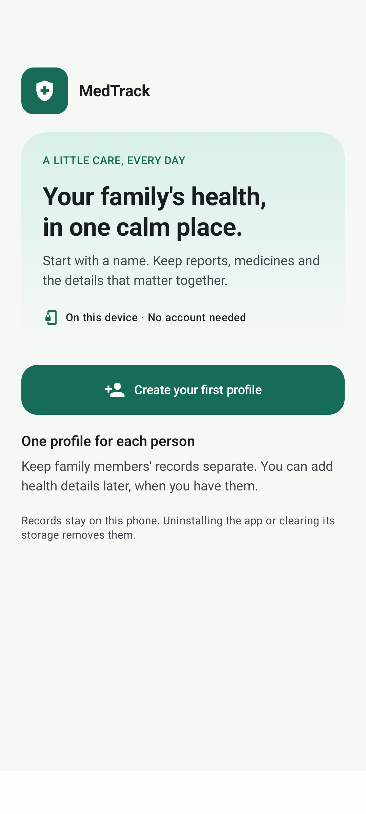
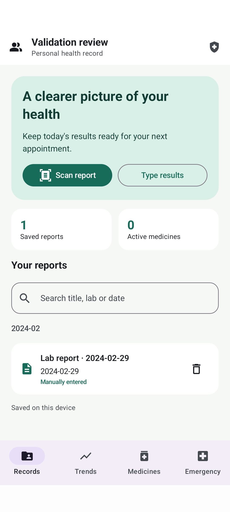
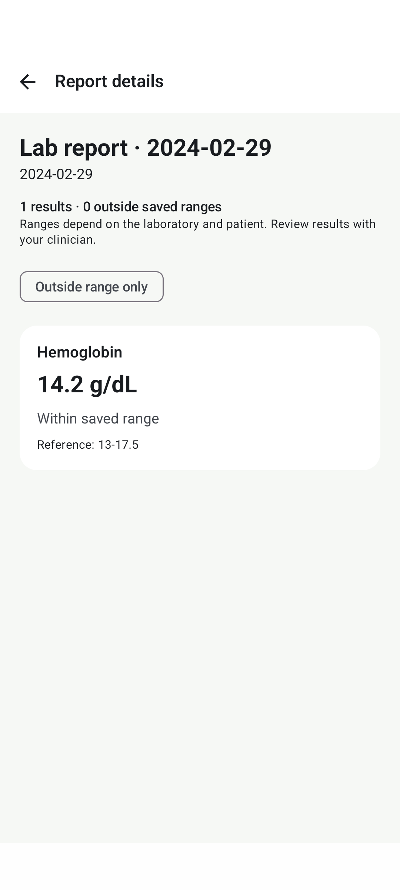
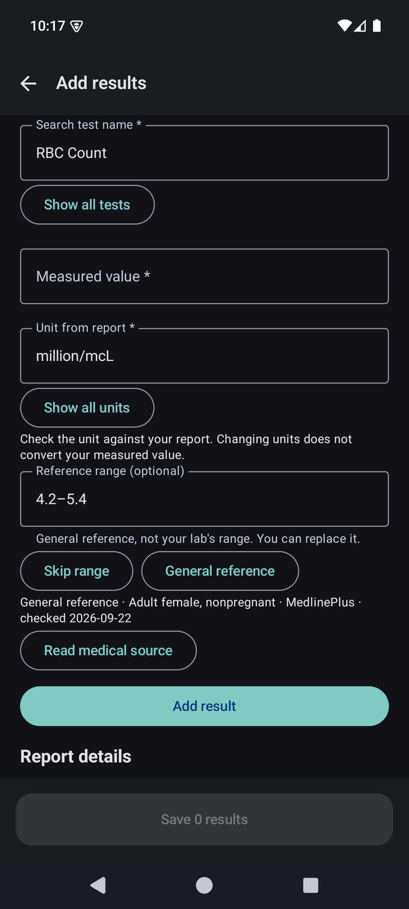
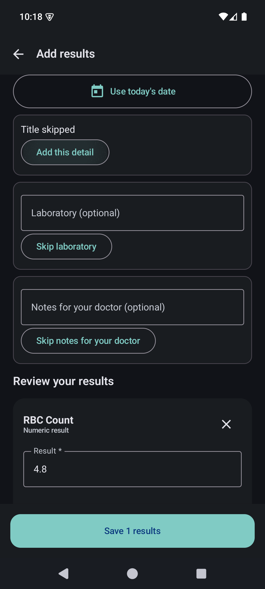
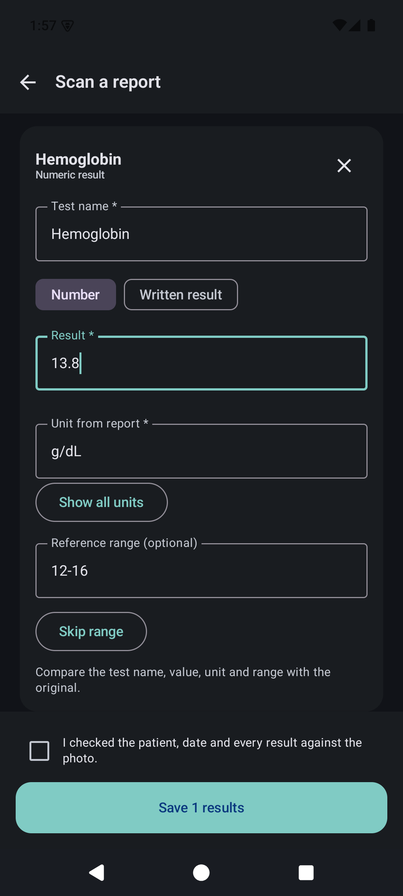

<div align="center">

# MedTrack

### Private, offline health records for you and your family

[](https://github.com/Lzefron/MedTech/actions/workflows/android.yml)
[](https://github.com/Lzefron/MedTech/releases/latest)
[](https://github.com/Lzefron/MedTech/releases/latest)

MedTrack keeps lab reports, trends, prescribed medicines, and emergency summaries together on the Android device. No account, API key, or remote database is required for its core features.

[Download the latest APK](https://github.com/Lzefron/MedTech/releases/latest/download/MedTrack-v1.2.1.apk) · [View all release files](https://github.com/Lzefron/MedTech/releases/latest) · [View automated builds](https://github.com/Lzefron/MedTech/actions)

</div>

> [!NOTE]
> This repository is private. GitHub will ask you to sign in with an account that has access before downloading a Release or Actions artifact.

## Preview

| Welcome | Records | Report details |
| --- | --- | --- |
|  |  |  |

| Test entry and sourced ranges | Clear Today and Skip actions | Scan and correct |
| --- | --- | --- |
|  |  |  |

## What it does

Version 1.2.1 removes API configuration and cloud-reading controls. Scanning runs entirely on the phone, fills editable fields, and keeps partial readings for correction. Add missing tests on the same screen, then save the original photo and recognized text with the reviewed results. No API key, account or hosting is needed.

Manual entry keeps prominent Today and Skip actions, editable units and sourced adult ranges. See [reference sources and coverage](docs/REFERENCE_RANGES.md).

- Creates a separate local profile for every family member and asks which profile to use when the app opens.
- Stores reports and original report photos privately on the device.
- Scans printed Latin-script lab reports with bundled, offline ML Kit text recognition, then requires the user to review every extracted value.
- Supports careful manual entry, written results, custom tests, strict dates, Bangla digits, and properly grouped numeric values.
- Groups reports by month, searches by title, laboratory, or date, and labels results using the saved reference range, with attribution when a general reference is used.
- Plots comparable numeric results while keeping incompatible units separate.
- Tracks prescribed medicines and daily reminder times without inventing a dose or schedule.
- Exports a paginated PDF health summary and emergency information.

## Install on an Android phone

1. Open [Releases](https://github.com/Lzefron/MedTech/releases/latest) while signed in to GitHub.
2. Under **Assets**, download `MedTrack-v1.2.1.apk`. The `.aab` file is only for Google Play Console and cannot be installed directly.
3. Open the downloaded file on the phone.
4. If Android asks, allow that browser or file manager to install unknown apps, then choose **Install**.

The current build supports Android 8.0 (API 26) and newer. Installing an update over the existing app preserves local records. Uninstalling the app or clearing its storage removes them.

## Google Play package

Upload **`MedTrack-v1.2.1.aab`** from the latest GitHub Release to Play Console. Its application ID is **`com.medtrack.app`**, version code is **4**, and version name is **1.2.1**. Do not upload the APK when creating a new Play Store app.

The bundle is signed with the private upload key kept outside this repository. See [`docs/PLAY_STORE.md`](docs/PLAY_STORE.md) for the exact release steps, required declarations, and future versioning rules.

## Privacy and safety

Room/SQLite data and copied report images remain in app-private storage. Android backup is disabled. The release has no internet permission and does not upload report photos. No analytics or advertising SDK is included. See [privacy policy](PRIVACY.md).

MedTrack is a personal record-organizing tool, not a medical device. It does not diagnose conditions, prescribe treatment, or replace a clinician. Missing reference ranges remain **not assessed** rather than being labeled normal. OCR output always requires human review.

Offline recognition is strongest on clear printed reports. Difficult handwriting, blurry images, Bangla text and unusual layouts may still be misread. A scan is a draft until you review and save it.

## Build locally

Requirements: JDK 17 and Android SDK 36.

```powershell
./gradlew.bat :app:testQaUnitTest :app:assembleDebug :app:lintDebug
```

The installable APK is generated at:

```text
app/build/outputs/apk/debug/app-debug.apk
```

Maintainers with the private upload key can generate signed Play and direct-install packages with:

```powershell
./Build-Play-Release.ps1
```

To run the isolated Android emulator tests:

```powershell
./gradlew.bat :app:connectedQaAndroidTest
```

The QA application uses the separate `com.medtrack.app.qa` package, so its test cleanup does not touch records in the main app.

## Verification

- Version 1.2.1 verification: 43 JVM tests and 5 focused Android emulator tests pass, covering offline OCR, editable fields, saving, local storage and absence of API controls/internet permission. The earlier 1.2 release also passed the full 13-test emulator suite.
- JVM coverage includes parser recovery, date selection, unit preservation and safe merging of AI suggestions.
- Android emulator coverage includes six-row OCR, manual corrections, saving the photo and recognized text, and upgrading existing records.
- Gateway tests simulate failed credentials, shared project quotas, malformed output and exhausted providers; no live key is needed.
- Android lint completes with 0 errors (27 existing warnings).
- Emulator coverage includes first-run profile creation, repeated profile selection, profile isolation, invalid input, transactional rollback, copied-photo retention, on-device printed OCR, and multipage PDF export.

## Technology

- Kotlin and Jetpack Compose
- Room database and Kotlin coroutines
- Bundled ML Kit text recognition
- Android alarms and notifications
- Android `PdfDocument`

## Future services

The app does not need a server. The experimental [vision gateway](vision-server/README.md) remains in the repository for future development but is not connected to version 1.2.1. Cross-device synchronization would require an encrypted remote database, conflict handling and deletion controls. Current medicine interaction information would require a licensed, maintained drug-information provider.

## Project notes

The implementation plan is retained in [`PLAN.md`](PLAN.md). The former duplicate `plan (1).md` had the same Git content hash and was removed.
